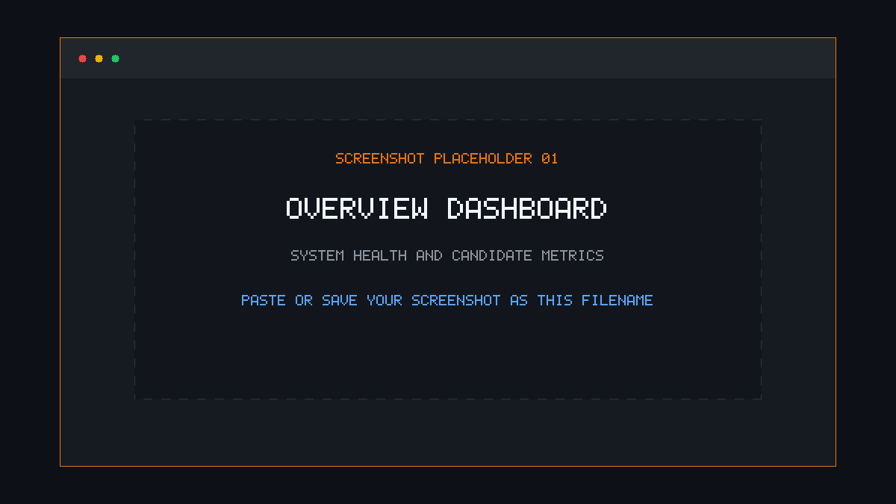
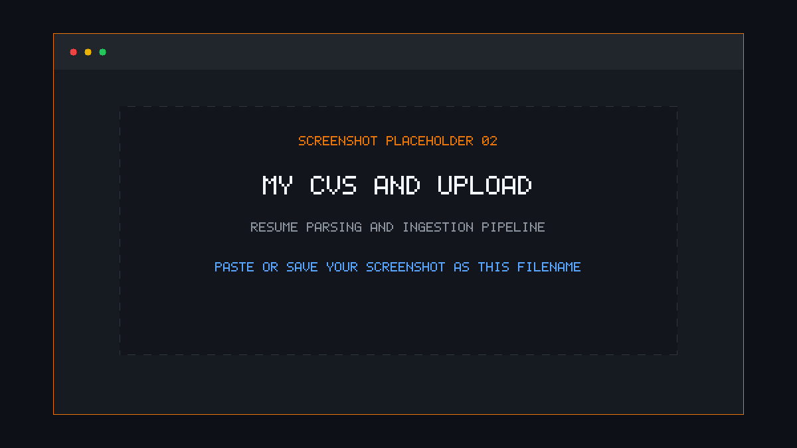
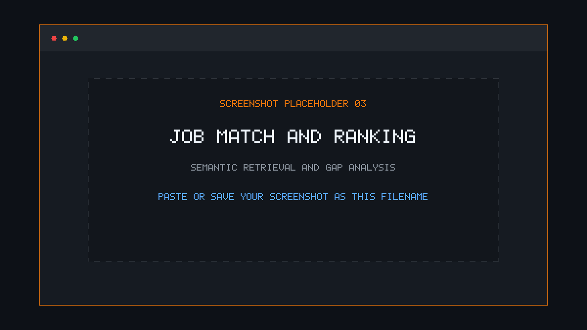
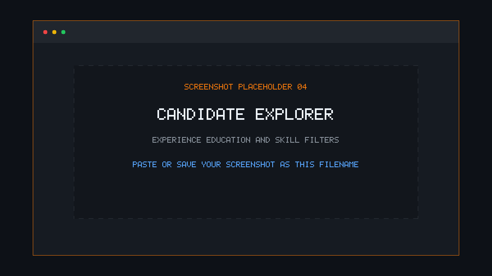
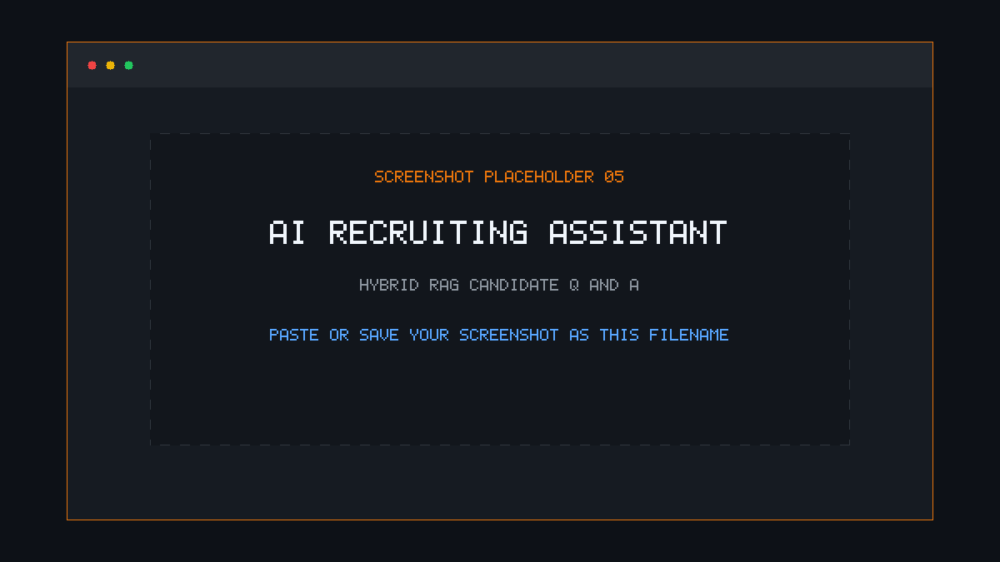
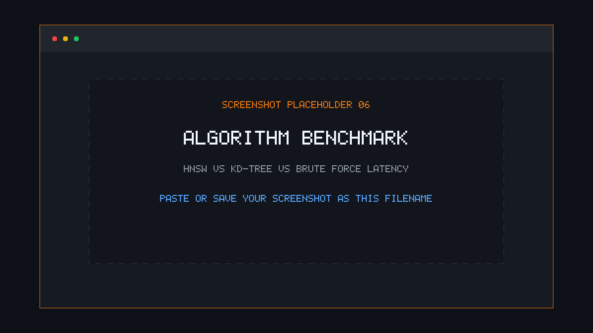

<div align="center">

# 🔍 CVLens — Offline AI Recruiting Assistant

### *Local-First Candidate Intelligence, Semantic Search & Explainable Resume Matching*

[](https://python.org)
[](https://ollama.com)
[](#-privacy--security-first)
[](#-search-algorithms-implemented-from-scratch)
[](./LICENSE)

<p align="center">
  <b>CVLens</b> is an offline AI recruiting assistant that allows talent teams to upload resumes, match candidates against job descriptions using dense and sparse hybrid retrieval, interrogate candidate profiles via an explainable RAG assistant, and benchmark search latency—<b>100% on device with zero cloud data transmission</b>.
</p>

</div>

---

## ⚡ What Makes This Different?

> 💡 **Zero Black Boxes:** Most AI search stacks rely on heavy external databases or pre-packaged vector stores (FAISS, Milvus, Chroma, Elasticsearch). **CVLens implements its core indexing and retrieval data structures from scratch in pure Python and NumPy**:
> - **Hierarchical Navigable Small World (HNSW)** graph for approximate nearest neighbors.
> - **KD-Tree** space partitioning for exact metric search.
> - **BM25 (Best Matching 25)** Lucene-style inverted index for sparse lexical matching.
> - **Reciprocal Rank Fusion (RRF)** for combining dense semantic and sparse keyword results.

---

## 📸 Interface Tour & Screenshots

<!-- Screenshot showcase section: Drop PNG images into docs/screenshots/ to update previews -->

> [!TIP]
> **To add or update your screenshots:** Replace the placeholder PNG files in [`docs/screenshots/`](./docs/screenshots/) using the filenames listed below. The README will automatically display your live screenshots!

### 1. Overview & Recruiter Dashboard
> Real-time system health check, Ollama connection status, candidate pool metrics, and quick-launch action cards.

<p align="center">
  
</p>

---

### 2. My CVs — Ingestion & Resume Parsing
> Multi-format resume ingestion (PDF, DOCX, TXT) via client-side parsers or direct paste. Resumes are automatically tokenized, chunked with contextual overlap, and vectorized.

<p align="center">
  
</p>

---

### 3. Job Match & Explainable Candidate Ranking
> Paste any job description to rank your candidate pool by similarity score. Features **Blind Review Mode** to mitigate unconscious hiring bias, plus LLM-generated rationale highlighting strengths and candidate gaps.

<p align="center">
  
</p>

---

### 4. Candidate Explorer & Attribute Filtering
> Structured candidate profiles extracted without ML dependencies. Filter dynamically across years of experience, minimum education degree, verified skills, and academic research publications.

<p align="center">
  
</p>

---

### 5. AI Assistant — Hybrid RAG Q&A
> Conversational recruiter assistant powered by hybrid retrieval (HNSW dense embeddings + BM25 sparse keywords). Questions cite specific candidates with factual grounding.

<p align="center">
  
</p>

---

### 6. Algorithm Benchmark & Telemetry
> Live performance benchmark executing the same query against HNSW, KD-Tree, and Brute-force indices to compare recall accuracy and latency in milliseconds.

<p align="center">
  
</p>

---

## ✨ Core Features

| Feature | Description |
|---|---|
| **🔒 100% Air-Gapped & Local** | Runs locally with Ollama. Zero API keys, zero network telemetry, zero data exfiltration. |
| **⚡ Hand-Crafted Search** | Pure NumPy implementations of HNSW, KD-Tree, Brute-force, and BM25 search engines. |
| **🔀 Hybrid RRF Retrieval** | Combines semantic vector proximity with lexical term weighting using Reciprocal Rank Fusion ($k=60$). |
| **🤖 Grounded RAG Assistant** | Recruiter Q&A agent backed by local `llama3.2` with strict candidate attribution. |
| **🎯 Explainable Match Rationale** | Automatic bullet-point fit and gap analysis generated on-demand for matched candidates. |
| **🙈 Blind Screening Mode** | Mask candidate names during initial evaluation to support unbiased merit-first reviews. |
| **📊 Structured Profiling** | Deterministic regex extraction of years of experience, education credentials, research indicators, and skills. |
| **⏱️ Live Telemetry Benchmark** | Real-time comparative latency and top-k recall measurement across index architectures. |

---

## 🏗️ Architecture & Data Pipeline

```
┌────────────────────────────────────────────────────────────────────────┐
│                        Browser Client (index.html)                     │
│    Client-side PDF.js / Mammoth.js text extraction → POST /cv/add      │
└───────────────────────────────────┬────────────────────────────────────┘
                                    │ JSON API
┌───────────────────────────────────▼────────────────────────────────────┐
│                       Flask Backend Server (app.py)                    │
│                                                                        │
│   ┌────────────────┐     ┌────────────────┐    ┌────────────────────┐  │
│   │  Chunking      │     │  Vectorization │    │  Indices           │  │
│   │  250-word text │ ──> │  nomic-embed   │ ─> │  ├─ HNSW (Graph)   │  │
│   │  50-word slide │     │  768-dim L2    │    │  ├─ KD-Tree        │  │
│   └────────────────┘     └────────────────┘    │  ├─ Brute Force    │  │
│                                                │  └─ BM25 (Sparse)  │  │
│                                                └────────────────────┘  │
│   ┌────────────────────────────────────────────────────────────────┐   │
│   │  Hybrid RAG Retrieval                                          │   │
│   │  Dense HNSW + Sparse BM25 ──(RRF k=60)──> Ollama llama3.2     │   │
│   └────────────────────────────────────────────────────────────────┘   │
│                                                                        │
│   ┌────────────────────────────────────────────────────────────────┐   │
│   │  Candidate Profiler (profiles.py)                              │   │
│   │  Regex & pattern rules: experience, education, skills, research │   │
│   └────────────────────────────────────────────────────────────────┘   │
└───────────────────────────────────┬────────────────────────────────────┘
                                    │
                         ┌──────────▼──────────┐
                         │  Local JSON Store   │
                         │  (cvlens_db.json)   │
                         └─────────────────────┘
```

---

## 🔬 Search Algorithms Implemented From Scratch

### 1. HNSW (Hierarchical Navigable Small World)
- Multi-layer graph representation balancing logarithmic routing speed with high recall.
- Tuned parameters: `M = 16` bidirectional connections per node, `efConstruction = 100`, `efSearch = 50`.
- Metric: Cosine similarity via L2-normalized vector inner product.

### 2. KD-Tree
- Binary space partitioning dividing 768-dimensional embedding space along the axis of maximum variance.
- Exact nearest neighbor branch-and-bound traversal with bounding-box distance pruning.

### 3. BM25 (Best Matching 25)
- Inverted index with document frequency lookup, average chunk length normalization, and term saturation.
- Tuned Lucene coefficients: $k_1 = 1.5$, $b = 0.75$.

### 4. Reciprocal Rank Fusion (RRF)
- Blends ranked lists from disparate retrieval systems:
  $$\text{RRF Score}(d) = \sum_{m \in M} \frac{1}{60 + r_m(d)}$$
- Guarantees candidates with strong keyword overlap and high semantic relevance surface at the top.

---

## 🚀 Getting Started

### Prerequisites

- **Python 3.10+**
- **[Ollama](https://ollama.com)** installed and running locally

### 1. Install & Pull Models

```bash
# Pull the required lightweight local models via Ollama
ollama pull nomic-embed-text
ollama pull llama3.2
```

### 2. Clone & Install Repository

```bash
# Clone the repository
git clone https://github.com/AsadChanzeb/Offline-AI-recruiting-assistant.git
cd Offline-AI-recruiting-assistant

# Install Python dependencies
pip install -r requirements.txt
```

### 3. Run Test Suite

```bash
# Execute unit tests verifying search algorithms and profiler logic
python -m unittest discover -s tests
```

### 4. Launch Application

```bash
# Start the local server
python app.py
```

Open your browser at **[http://localhost:8080](http://localhost:8080)**.

> 🌐 **Note:** On first launch, the browser UI pulls PDF.js and Mammoth.js from public CDNs for client-side document parsing. Once cached, all runtime operations are 100% local and offline.

---

## 📡 REST API Reference

| Method | Endpoint | Description | Payload / Parameters |
|---|---|---|---|
| `GET` | `/` | Serves the single-page application dashboard | None |
| `GET` | `/status` | Service health status and database statistics | None |
| `GET` | `/cv/list` | List all indexed resumes with chunk counts | None |
| `POST` | `/cv/add` | Ingest and index a new resume | `{"text": "...", "name": "..."}` |
| `DELETE` | `/cv/delete/<id>` | Remove candidate and associated index nodes | URL parameter `id` |
| `POST` | `/cv/clear` | Purge all candidates and reset indices | None |
| `POST` | `/match` | Rank candidates against a job description | `{"jd": "...", "algo": "hnsw", "k": 10}` |
| `POST` | `/explain` | Generate LLM match strengths and gap analysis | `{"jd": "...", "cv": "..."}` |
| `POST` | `/candidates`| Retrieve structured candidate profiles | `{"jd": "..."}` (optional) |
| `POST` | `/ask` | Hybrid RAG conversational query across resumes | `{"question": "..."}` |
| `POST` | `/benchmark`| Execute latency and recall benchmark | `{"text": "..."}` (optional) |

---

## 📁 Repository Structure

```
Offline-AI-recruiting-assistant/
├── app.py                  # Core backend: Flask API, HNSW, KD-Tree, BM25, and RAG logic
├── profiles.py             # Deterministic regex-based candidate profile extraction
├── index.html              # Modern, responsive single-page application interface
├── requirements.txt        # Minimal Python dependencies (Flask, NumPy, Requests)
├── LICENSE                 # MIT License
├── README.md               # Project documentation and visual guides
├── cvlens_db.json          # Local persistence database (git-ignored)
├── docs/
│   └── screenshots/        # UI screenshots & preview assets
│       ├── README.md       # Asset upload instructions
│       ├── 01-overview.png
│       ├── 02-upload-cvs.png
│       ├── 03-job-match.png
│       ├── 04-candidate-explorer.png
│       ├── 05-ai-assistant.png
│       └── 06-benchmark.png
└── tests/
    └── test_core.py        # Unit tests for vector math, chunking, BM25, and candidate profiling
```

---

## 🔒 Privacy & Security First

- **Zero Cloud Leakage:** All embeddings, vector operations, and LLM text generation occur on `128.0.0.1` / `localhost`.
- **Candidate Confidentiality:** Fully compliant with strict data protection and GDPR policies—no resume data is sent to external AI APIs.
- **Auditable Algorithms:** Every ranking calculation and search index is fully inspectable in pure Python.

---

## 📄 License

This project is licensed under the MIT License — see the [LICENSE](./LICENSE) file for details.

Developed with ❤️ by [Asad Chanzeb](https://github.com/AsadChanzeb).
